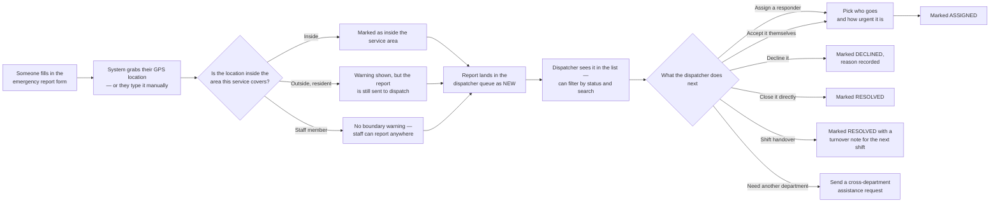
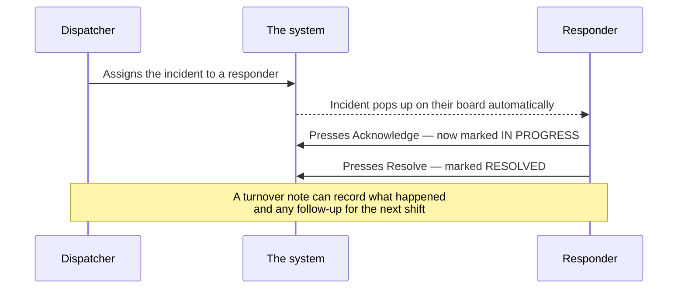

# Emergency Response System — How It Works (Plain English)

This document explains what the system does, step by step, without the technical jargon.

## Who uses it

| Who | What they do | What they see when they log in |
|-----|--------------|-------------------------------|
| **Resident** | A regular community member who reports emergencies | Their own dashboard — report a problem, manage emergency contacts |
| **Dispatcher** | The person who reads incoming reports and sends help | A queue of every incoming emergency, ready to be assigned |
| **Responder** | Field staff (ambulance, fire, police) who go out to incidents | A board showing only the incidents assigned to them |
| **Admin** | Runs the whole system | Everything, plus user approvals, departments, and settings |

Anyone can open the sign-in, registration, and password-reset pages. Everything else requires being logged in — and each page also checks that your role is allowed there.

## 1. Signing up and getting approved

New residents can't just start using the system — an admin has to approve them first.

```mermaid
flowchart LR
    A[Fill in registration form<br/>name, email, password, ID photo] --> B{Is that name<br/>already taken?}
    B -->|No| C[Account is created]
    C --> D[System automatically saves:<br/>your profile, your ID photo<br/>for review, your emergency contacts]
    D --> E[You can log in,<br/>but the account is "pending"]
    E --> F{An admin reviews<br/>your registration and ID}
    F -->|Approve| G[Account becomes active<br/>— fully usable]
    F -->|Reject ID| H[ID marked rejected —<br/>account stays pending]
    F -->|Ask for clearer photo| I[You upload a new ID photo]
    F -->|Reject the whole signup| J[Registration removed]
```

What happens behind the scenes:

- When you press **Register**, the system checks nobody else already has your name, then creates your account.
- Your profile, your ID-verification record, and your emergency contacts are all created automatically at that moment — nothing needs to be filled in twice.
- Until an admin approves you, the account exists but isn't active.
- Admins do this review from **Residents & review** on the dashboard: one panel for approving new registrations, another for checking uploaded IDs.

## 2. Reporting an emergency and getting it assigned



Every report carries: who reported it, what kind of emergency it is, a description, how urgent it is, where it happened (map pin plus a written address), the reporter's contact details, whether it was inside the service area, and any photos.

## 3. The responder does the work and closes it



- The responder's board only shows incidents assigned to that responder, and it updates live — no need to refresh the page.
- The life of an incident is: **new → assigned → in progress → resolved**. A report can also be **declined** by the dispatcher, which ends it too.
- The red number badge on the queue button shows how many unresolved incidents are still open.

## 4. Everything else

- **Emergency contacts** — each user keeps a list of contacts (name, relationship, phone number, and a "primary" flag) in their profile. Contacts entered at signup are saved automatically.
- **Departments** — admins create departments (fire, medical, police...) and put staff into them. This is what the cross-department assistance requests use.
- **Notifications** — the bell icon in the top bar shows updates; the system can push live updates for a report as they happen.
- **Forgot your password?** — the reset link from the email opens a page where you set a new password.
- **Service boundary** — admins can redraw the area the service covers on a map. The report form uses that boundary to decide whether a location is "inside" or "outside" the service area.
